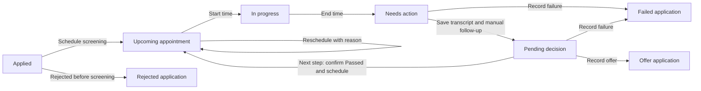
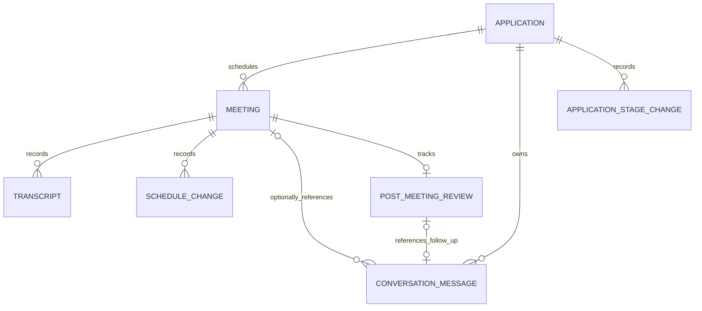

# Meeting and application domain design

Status: architecture and interactive mock UI, updated 2026-11-11. Applications search and the mock workflow are implemented. The canonical repository, live-record workflow migration, durable editor drafts and complete cross-view transaction model below remain proposed.

The interactive prototype uses five existing mock meetings: Harbor Analytics, Coastline Logistics, Willow Health, Pixel Studio and Cobalt Cloud. Their cards have blinking red borders. Clicking the fixed Needs action notification reveals the next actionable meeting with a lime border and glow; it does not open an editor or mark anything complete. Further clicks cycle through the actionable cards. The contextual Update sheet remains available from mock application cards, meeting details and the web Applications toolbar. Mock next-step scheduling, rescheduling, failure and offer recording persist to local sample storage through an authorized worker handler with revision checks and retry receipts. Search in the dock filters company and role without affecting Job Queue. Unsubmitted editor text is retained during navigation in the current page; it is not yet a durable draft across page reloads. Live records continue using their existing editor, preserving the current stage instead of preselecting Screening.

The typed records and response shapes are in [meeting-domain-contracts.ts](meeting-domain-contracts.ts).

The user confirmed that follow-up email is entered manually for now. The workflow records an email the user sent outside the extension, or links an existing sent email in Chat history. It does not open an email composer, connect an email account, or send messages. A draft is saved as a draft, never represented as a sent follow-up.

The central change is two Update flows: **Complete meeting** collects the transcript and follow-up after an appointment ends, then marks it Pending; **Next step** schedules Screening from Applied or advances a reviewed Pending screening/interview after the user confirms a successful result. Upcoming meetings offer Reschedule. Failed remains an explicit alternative.

## Core structure

One submitted application owns its entire recruiting history. It can have several screening calls, up to six interview rounds, multiple sessions within a round, and one continuous conversation timeline. Offer, Rejected, and Failed are application outcomes, never meeting kinds. `archived` remains the legacy storage value for the visible Failed stage; it is not an Archive action.

The recruiting journey starts with Screening, followed by interview Round 1. Progression requires a completed screening marked Passed. Starting an interview preserves the screening's dates, transcript and conversation, then creates a separate interview draft with its own schedule and joining details. Screening remains the first entry in interview and outcome histories. Existing imported records with missing history must not receive invented screening events.

## Update workflow

The application card's **Update** button opens an update sheet whose mode is returned by the workflow service. It must stop selecting Screening unconditionally: updating an Interview or Offer record must not move it backwards. Applications, dock meetings, and web meetings use the same action resolver. Saving a workflow update must never modify submitted documents.



| Current state | Update action | Save behavior |
| --- | --- | --- |
| Applied | Next step: Schedule screening | Create a screening meeting and move the same application to `screen` atomically. |
| Screening/interview draft, date not known | Set meeting time | Fill the existing draft; preserve its ID. |
| Upcoming screening/interview | Manage schedule: Reschedule / Edit details | Preserve meeting identity; retain every old appointment and its reason under Previous meetings. |
| Ongoing screening/interview | View meeting / Edit details | Keep join access; do not request post-meeting work before the end time. |
| Ended meeting with unfinished post-meeting work | Complete meeting | Save transcript and manually recorded follow-up. When both requirements are resolved, confirm completion and show Pending; partial saves remain Needs action. |
| Screening, reviewed and Pending or Passed | Next step: Schedule interview | User confirms the screening Passed; create Round 1, retain screening history, and move to `interview` in one save. |
| Interview, reviewed and Pending or Passed, rounds 1–5 | Next step: Schedule next round | User confirms the prerequisite session(s) Passed; create round `n + 1`. No separate result screen is required first. |
| Interview, reviewed and Pending or Passed, round 6 or Final | Record offer / Await decision | Never create round 7. A final round requires an explicit offer or failure; Pending can remain while awaiting a response. |
| Ended screening/interview, including Needs action | Mark Failed | Record the negative result and application outcome, preserving transcripts, conversation and previous meetings. |
| Applied, or screening/interview not yet completed | Record rejection/withdrawal | Rejected before any completed recruiting meeting; otherwise Failed application. Do not falsely mark a future meeting Failed. Explicitly cancel affected appointments. |
| Any active stage | Add session / Add message | Further screening or a panel/marathon session retains the step; a message alone never advances it. |
| Offer, Rejected, Failed | View/update record and history | No automatic next step. Historical unfinished work still opens Complete meeting by meeting ID. Reopening is an explicit correction. |

**Scheduling form.** Show the company and role, selected timezone, start/end, Phone or Video, the appointment's own phone number or meeting link, interviewer(s), and optional topic tags. Screening has no round selector. Interview starts with the proposed next round; another panel/marathon session uses **Add session to this round**. Do not copy a previous meeting's joining details silently.

**Schedule later.** If an invitation has arrived without a time, the user may explicitly save a draft with `lifecycle: draft`. The application can enter Screening or Interview, but the draft is listed under Not scheduled, excluded from the calendar/time-based focus, and has no Upcoming/Pending badge or join action. Publishing that same draft requires a complete schedule and joining details. Canceling the form performs no write.

**Progression rule.** Pending is waiting for a decision, not a failure and not a reason to hide Next step. Selecting Next step is the user's report that progression was confirmed. Its sheet explicitly says which screening/session(s) will be marked Passed and collects the next invitation's details. Save rechecks that all required sessions have ended and their post-meeting work is resolved, records those Passed results, then creates the next step atomically. Already Passed sessions need no second result confirmation. A no-show or unresolved sibling session must be addressed first. Round 1 follows screening; rounds stop at 6. Existing imported future rounds are preserved for review rather than having successful results invented.

**One save, one transition.** Complete meeting ends with **Save & mark Pending** (or **Save & next** when reviewing the action queue). When the meeting already has a Passed/Failed result, label this **Save completion** and preserve that result. Complete meeting never schedules another appointment. Next step ends with **Save next step**, committing the confirmed Passed results, new meeting/draft, application stage, and history event together. If validation fails, nothing is partially saved and the form stays filled. **Save draft** retains unfinished content without clearing Needs action. IDs are allocated once per mutation so double clicks and retries cannot duplicate appointments or follow-up messages.

**Failure versus rejection.** A rejection before any completed recruiting meeting is Rejected and has no Previous meetings tab. A negative outcome after screening/interview is Failed and retains previous meetings. Closing an application never fabricates a result for an unrelated session. If future appointments exist, the sheet lists them and records which ones the user explicitly cancels in the same closing action. Cancelling an appointment alone does not reject the application.

**Submitted documents.** Record the exact resume, optional cover letter, document settings and candidate snapshot at submission, alongside salary and application date. That document bundle is immutable in Applications: profile replacement, meeting edits, transcript saves, chat entries and stage changes never regenerate it. Queue documents stay editable before submission. Manually entered/imported applications without saved documents remain documentless; only the mock partition receives generated examples.

## Applications search

The web Applications filter already searches company or role; the dock list currently renders all applications. Add the search control directly above the dock's application cards, with placeholder **Search company or role**, a clear button, and an accessible label. Keep the queue card layout and its four actions unchanged. Search state belongs to Applications and does not filter Job Queue when switching tabs.

Use one application-query service and normalization rule in web and dock: trim, normalize case/diacritics, split on whitespace, then require every token to match either company or job title. This supports `cedar engineer` across the two fields. Use literal substring matching, not regular expressions. Start with those two fields; do not search transcript or email bodies implicitly.

Combine search with the existing status and date-period filters: All, This month, Last week (rolling seven days), Last 3 days, and Last 24 hr. Application periods use `appliedAt`, not the next appointment date or last edit. Unknown application dates appear under All and are excluded from dated filters. Reuse the shared timezone/date helpers. Preserve sort and filter state when returning from details, the action queue, or Dashboard. Clear resets the query; Clear filters resets all filters.

Return `filteredCount`, `totalCount`, and stable cursor pagination. Search runs before pagination; it must find off-screen applications. Debounce requests by about 150 ms, invalidate the cursor on a filter change, and ignore stale responses. Keep the input focused while results update, display a clear no-results state, and keep navigation usable during a pending request. A saved update preserves the current query and rechecks whether the edited application still matches.

## Post-meeting work and Needs action

Keep three separate concepts: the application's pipeline stage, the meeting's recruiting result, and its outstanding work. `Needs action` is a derived attention flag, never a new application stage or a replacement for a stored Passed/Failed result. Show it as a glowing red border on all four edges of the meeting cards, without a Needs action badge. For an undecided elapsed meeting, omit the Pending badge until post-meeting work is finished. Keep the review counter at the top and announce Needs action in the card's accessible name.

An appointment becomes eligible exactly at `endsAt <= now`, using both date and time. It must have a confirmed schedule and be a real non-deleted screening/interview, with lifecycle scheduled or completed. Upcoming, ongoing, draft, cancelled, no-show, legacy schedule markers and rescheduled previous-slot projections do not enter the post-meeting queue. Unknown end times require schedule review; never assume midnight or a default duration.

Each eligible meeting normally requires:

1. **Transcript:** saved nonempty transcript for this meeting. If no transcript exists, the user may explicitly choose **Transcript unavailable** and enter a reason; do not store that reason as a fake transcript.
2. **Follow-up email:** a manually recorded sent email linked to this meeting, or an existing qualifying email selected from this application's Chat history. If follow-up is inappropriate, allow **Not required** with a reason. A missing recipient is not an invented address or an automatic exemption.

The completion sheet shows these two items and their current values. The normal path requires both; exceptions are explicit, recorded decisions. Save & mark Pending verifies both and records `PostMeetingReview.completedAt` and attendance/completion in the same transaction. An undecided `result` remains `pending`; an existing Passed/Failed result and the application's stage are preserved. Partial draft saves neither confirm attendance nor clear the glowing red border. Opening or visiting an item never marks it done.

The service derives attention reasons `transcript_missing`, `follow_up_missing`, or `review_unconfirmed`. The last covers records whose content was saved separately but never confirmed through Complete meeting. A review completed earlier is rechecked against its linked records: removing a required transcript/email reopens the corresponding item; restoring it restores its resolved state. Editing a transcript does not erase a valid follow-up or alter Passed/Failed. Explicit exception reasons can be replaced with actual content later.

Newly created meetings use `reviewPolicy: required`. Known historical Passed/Failed records and already closed applications at migration use `legacy_optional`, so installation does not demand follow-ups for every old round. Known active undecided elapsed meetings become actionable. The policy records migration provenance; clients cannot disable it through a generic edit. Explicitly starting Complete meeting on a legacy-optional record opts that meeting into required review.

**Failure and closing.** Mark Failed, Reschedule, Cancel and No-show remain available without inventing a transcript or sending a follow-up. A Failed/Offer result does not silently mark existing unfinished work done. Its sheet may explicitly resolve an inappropriate follow-up or unavailable transcript with reasons; otherwise that historical meeting remains in the action queue and opens directly by ID, even if the board now displays an outcome application card. Rejected has no Previous meetings tab and cannot be used to discard a completed recruiting history. Rescheduling an elapsed slot requires confirmation it did not occur; an attended/completed appointment gets a distinct new meeting instead. Preserve any saved content in either case.

**Reschedule isolation.** A meeting retains its canonical ID, with `scheduleVersion` incremented only when its actual start/end instants change. Formatting the same instant differently or changing the display timezone does not increment it. Transcripts, post-meeting reviews and linked follow-ups identify the applicable schedule version. Rescheduling retains earlier versions and records both versions on ScheduleChange, but only the current version can satisfy current work. Thus an old draft, transcript, sent email or review cannot silently clear a newly rescheduled appointment. The old event's Transcript display remains the rescheduling reason; any original content remains separately preserved.

## Needs action count and guided review

Show a red, text-labelled **Needs action · N** button at the top right of Meetings, including the dock. `N` is the number of distinct actionable meeting IDs in the active account/partition, not the number of missing fields or applications. A meeting missing both transcript and follow-up counts once. Multiple sessions needing attention count separately. Applications shows no Needs action notification, count, or card highlights; outcome cards still represent applications, not fictitious meetings.

The header count includes all actionable meetings in that partition, independent of the current search, period, pagination, or board column. Clicking the notification reveals the next actionable meeting in the board or dock list with a lime highlight, clearing meeting filters when needed. Only one card is highlighted at a time; further clicks cycle through current actionable cards. The click never opens an editor or changes the count. At zero, show All caught up without blinking or navigation. Editing starts only through an explicit Update or Complete meeting action; the guided editor below is separate from notification navigation.

Open a single review panel in the existing dock/detail area, not another browser window or stacked modal. Load each meeting's full context by canonical ID. The review session captures an ordered set of IDs, oldest end time first, then sequence/session and ID. Show company, role, step, original time, `item X of Y`, and the live remaining count. Provide **Previous**, **Skip for now**, **Save & next**, and **Exit review**. Skip changes navigation only; it neither dismisses the task nor lowers the count.

Save & next advances only after the service acknowledges complete post-meeting work. On validation errors, conflicts or a timeout, remain on the current item and retain input; retry with the same mutation ID. A timed-out request may already have committed, so query its receipt before creating a new mutation. Completion removes that meeting from the live queue but retains its ID in the review session for navigation. If the last item is resolved, show **All caught up**; if items were skipped, offer **Review remaining**. Do not wrap endlessly through skipped items.

Recheck an ID when opening it. If another tab completed, cancelled, rescheduled or deleted it, skip it with a short explanation; never overwrite the other tab's update. New tasks arriving during a session increment the count and show **New items available**; they do not reorder the current session or steal focus. Refreshing the queue explicitly includes them. Exit restores the originating page's search, filters, selection and scroll. Drafts belong to meeting IDs and are retained privately across navigation; Cancel edits/Escape follow the editor's explicit discard behavior without affecting already saved items.

Store the review session's ordered IDs and schedule versions in private session storage. Pagination walks that frozen snapshot; each item is rehydrated and revalidated on open. Worker restarts can resume the session without taking a new ordering. A meeting with a changed schedule version is a changed item, even when its canonical ID is the same. Newly eligible versions join a refreshed session rather than receiving edits intended for the old slot.

Use a shared clock snapshot for badges, counts and queries. Recompute at the next relevant start/end boundary, on visibility/focus, reconnect, and relevant storage invalidation. A sleeping worker does not need a permanent timer: each read recomputes eligibility from current time. Timezone changes affect rendering, never eligibility. Do not persist a counter as the authority; it is a projection of meetings, review policies, transcripts and linked follow-ups.

## Adding transcripts and chat history

| UI location | Action | Ownership and effect |
| --- | --- | --- |
| A meeting after its end time, Transcript tab | Add transcript / Edit transcript | Paste text or upload UTF-8 `.txt`; preview and save to this meeting only. |
| Ended meeting, Complete meeting sheet | Transcript + Add follow-up email | Save meeting-specific transcript and a manually recorded sent email; explicit completion clears Needs action and exposes Pending. |
| A screening's or interview's Previous meetings tab | Select a screening or round/session, then Add/Edit transcript | Use the selected historical meeting ID and schedule version. Rescheduled slots retain their reason under the Transcript label. |
| Any application or meeting, Chat history tab | Add message | Add one message to the application's shared timeline, optionally linked to this meeting. |
| An existing chat entry | Edit message / Remove message | Revision-checked correction or soft deletion of that entry; preserve other messages and audit history. |

Use these same actions and service commands in the web page and dock. Opening a read-only history snapshot must not expose an editor until its original canonical meeting ID has been resolved. Offer and Failed can expose Previous meetings; Rejected does not. Chat remains available for all application outcomes and before the first screening.

**Transcript editor.** Keep one current transcript per meeting/schedule version and retain earlier text revisions. Plain text is authoritative; replacing it clears old speaker/timestamp segments unless the user imports matching replacement segments. Show the selected meeting's company, date, round/session and interviewer above the editor. Support pasted/manual text and plain-text file import first; audio transcription and automatic chat/email synchronization are separate future features. A transcript can be added before the result is known or edited after the application closes. Saving it does not mark the meeting Passed, move the application, or overwrite chat. Validate nonempty text and a proposed 1 MiB UTF-8 limit before saving. Emptying an existing transcript requires an explicit Remove action with Undo rather than silently erasing it.

**Message editor.** Capture sender, recipients, actual sent date/time with timezone, and body. Prefill known candidate/contact information as suggestions; do not invent unknown senders or message times. `meetingId` is an optional association for navigation. Save adds the message to the same full application timeline shown from every round. Editing targets the original message ID; a message added at Round 5 must also be visible when opening chat from Screening. Saving is a local record operation and never sends email or chat to anyone.

**Manual follow-up entry.** Label this action **Add follow-up email**, with help text **Record an email you already sent**. Capture From, To, Subject, sent date/time in the selected timezone, and body, plus an explicit **Already sent** confirmation. The service requires an identified sender, nonempty recipient, subject/body, a non-future sent instant at or after this meeting's end, and a link to this same application, meeting and schedule version. Unknown data can remain in a private draft until completed. An exception such as a legacy email with an uncertain date belongs in undated history and does not silently satisfy the follow-up requirement.

Persist a qualifying entry as `ConversationMessage { channel: email, direction: outgoing, purpose: follow_up, evidence: user_confirmed, meetingId, meetingScheduleVersion }` and reference its ID from `PostMeetingReview`. It appears once in the shared newest-first Chat history. The user may select an existing qualifying sent email instead of pasting a duplicate; linking a generic outgoing email records the explicit follow-up purpose and meeting association. Incoming recruiter messages and unknown-direction imports cannot satisfy the requirement without an explicit metadata correction. One message satisfies one meeting in this version; do not silently count the same email for every round or panel session. Imported provider IDs remain useful for deduplication, but no provider integration is needed for manual entry. Replacing the selected follow-up retains the earlier message in history.

Complete meeting saves the transcript change, review resolutions, new/linked follow-up, completed lifecycle and mutation receipt atomically. If either field is invalid, nothing is partly committed and the local draft remains. Independent Transcript/Chat edits remain possible and never advance the application; they invalidate the attention projection if a referenced item changes. **Save draft** stores editor input separately from authoritative transcripts/sent messages, so incomplete email text does not appear in Chat history as sent.

**Pasted conversation.** Offer Add message for a single message. For a pasted thread, show a reviewable list of parsed entries before import; only entries with confirmed sender/time metadata enter the dated timeline. Keep unresolved text as an undated fragment. Deduplicate by source provider/thread/message IDs when available, or by the user's import batch and entry IDs on retry; do not discard two genuine messages merely because their text matches. Proposed limits are 128 KiB per message and 1 MiB per pasted import. No AI parsing is required for the first version.

**Saving and conflicts.** Keep form text locally while editing. Save, Cancel, and Escape affect only that editor; Cancel/Escape discard its unsaved draft. For a changed record, show the current saved revision alongside the local draft and let the user review before retrying. Preserve a removed transcript/message for Undo. Sorting and separators always use the message's actual sent instant converted to the selected display timezone, never the import or save time.

## Current implementation gaps

- `job-records-view.js` currently opens application Update with `screen` selected, and `dock-records-service.js` saves the stage without creating a screening appointment. Replace that path with the scheduling/update sheet above.
- `meetings-board-page.js` writes embedded meeting data separately from application updates. Move both writers behind one application/meeting repository so the dock, Applications, and every meeting view agree after a save.
- `meetingRecordUpdate()` currently turns the current embedded meeting into an interview while copying screening into history. Replace this with separate meeting entities and stable IDs. Do not repeatedly copy full transcripts/messages into later rounds.
- The web dialog currently edits a past meeting's transcript inline; historical entries and dock meetings are read-only, and chat has no add/edit flow. Use meeting-specific transcript and application-scoped message commands for the new editors.
- Mock application overrides and mock meeting rows are separate today. Preserve both during migration, then make mocks use the same commands with an isolated partition. Never sync generated samples into live applications.
- Web Applications already has company/role search and period filters; the dock has no application query state and renders the full list. Share the query semantics and implement the dock control.
- `meetingStatus()` currently shows Pending from the start time. It cannot distinguish ongoing meetings, unfinished post-meeting work, and reviewed meetings awaiting a decision. Replace the badge projection with the timing/review rules below.
- The existing reschedule implementation retains original slots and their reasons. Preserve that behavior while migrating embedded schedule history to canonical ScheduleChange entries; those slots never become attention tasks.



| Record | Responsibility | Important fields |
| --- | --- | --- |
| Application | Company, role, application stage and stable identity | `id`, `profileId`, `companyName`, `jobTitle`, `stage`, `stageChangedAt`, `sourceRefs` |
| Meeting | A real screening or interview appointment | `id`, `applicationId`, `kind`, `round`, `sequence`, `sessionIndex`, `schedule`, `lifecycle`, `channel`, `topics`, `participants`, joining details |
| ConversationMessage | One message in the application's complete chat/email history | `applicationId`, optional `meetingId`, `sender`, `recipients`, `sentAt`, `bodyText`, optional provider IDs |
| Transcript | The transcript of one particular meeting | `meetingId`, `applicationId`, `rawText`, optional timestamped speaker segments |
| PostMeetingReview | Explicit completion and exceptions; links content without copying it | Unique `(meetingId, scheduleVersion)`, `completedAt`, `transcriptUnavailableReason`, `followUpMessageId`, `followUpNotRequiredReason` |
| ScheduleChange | An actual reschedule, retaining the old time range | `meetingId`, `previousSchedule`, `nextSchedule`, event time and reason |
| ApplicationStageChange | Movement of the application through its pipeline | `applicationId`, `from`, `to`, `occurredAt` |
| SubmissionDocuments | Frozen resume and optional letter used for submission | `applicationId`, `submittedAt`, `resume`, `coverLetterRaw`, candidate/template snapshots |
| LegacyFragment | Existing information whose identity, timestamp or meeting kind is unknown | Original text/metadata and its source references |

All records have an immutable UUID, revision, creation/update timestamps and a `live` or `mock` partition. A meeting, transcript or message must belong to an application in the same partition. Company name and job title are display fields, not identifiers: applying twice for the same role creates separate application histories.

## Application records versus meetings

`Application.stage` retains the existing values: `applied`, `screen`, `interview`, `offer`, `rejected`, `archived`. `Meeting.kind` permits only `screening` and `interview`. A meeting's kind and round do not change when the application's stage changes.

The board service returns two distinct card types:

| Column | Card type | Source |
| --- | --- | --- |
| Screening | Meeting | Screening appointments for applications currently in screening |
| Interview | Meeting | Interview appointments for applications currently in interview |
| Rejected | Application | One record per rejected application |
| Failed | Application | One record per failed application (`archived` in legacy storage) |
| Offer | Application | One record per application at the offer stage |

An application that reaches Interview keeps its screening calls in its history. An application that reaches an outcome column keeps all its appointments and messages, but that column displays one application record rather than a card for each old round. Outcome cards have no meeting time, phone/video tag, round or join link. They show Last updated from the application's `updatedAt`; retain `stageChangedAt` separately for audit. Transcript/message edits use their own timestamps and do not rewrite the application date or meeting schedule.

Changing an application to Offer does not create an appointment or rewrite an interview into an offer meeting. It also does not silently cancel an existing appointment. Cancellation is an explicit separate command. Existing appointments remain accessible through the application's history.

If a closing action explicitly keeps a future appointment, it remains a real calendar event with its existing ID and joining details, while the application board displays the outcome record. The user can subsequently cancel it. Outcome records themselves never appear as calendar appointments.

Applications with no scheduled appointment do not receive invented meetings. They remain available in Applications; scheduling creates an actual Meeting record. A future UI may show a clearly identified application placeholder, but it must use the application card contract.

Dragging a card opens the same applicable transition sheet as Update. Closing uses `APPLICATION_SET_OUTCOME`; progression uses `APPLICATION_ADVANCE`. A generic stage edit must not bypass their validation or create an appointment implicitly. Moving a meeting must never directly rewrite `Meeting.kind` from one column label to another. Progressing a screening application to Interview updates its stage and creates a distinct interview appointment/draft; the screening appointment remains historical data.

## Tags, interview rounds and rescheduling

Screening and Interview are identified by their column and card color, not additional tags. Every view, detail/history panel and progress cell uses the same projection for **Upcoming**, **Needs action**, **Pending**, **Passed**, and **Failed**. The service stores result `pending | passed | failed`; Upcoming and Needs action are derived. **In progress** is a temporary time annotation while a meeting is ongoing, not a new saved result. Phone/Video, round and topic rules remain shared across views.

| Meeting condition | Status presentation |
| --- | --- |
| Draft / incomplete schedule | None; show Not scheduled separately |
| Scheduled, result pending, `now < startsAt` | Upcoming |
| `startsAt <= now < endsAt`, result undecided | In progress time annotation; no Pending badge yet |
| Ended, result undecided, required review unfinished | Glowing red border on all four card edges; no Needs action badge |
| Ended, result undecided, review completed or legacy-optional | Pending |
| Explicit passed result, meeting ended | Passed; glowing red border remains for unfinished work |
| Explicit failed result, meeting ended | Failed; glowing red border remains for unfinished work |

Cancelled/no-show are exceptional lifecycle annotations, not Passed/Upcoming aliases. Store them separately and omit them from active meeting/progress lists. A clock tick never makes an appointment Passed. Previous-meeting and calendar badges receive the same current time and timezone context as the board.

The tag editor exposes the requested options:

| Display label | Canonical value | Stored source |
| --- | --- | --- |
| Phone | `phone` | `Meeting.channel` |
| Video | `video` | `Meeting.channel` |
| Rescheduled | `rescheduled` | Schedule-change history |
| Panel | `panel` | `Meeting.topics` |
| Marathon | `marathon` | `Meeting.topics` |
| Final | `final` | `Meeting.topics` |
| Technical | `technical` | `Meeting.topics` |
| System Design | `system_design` | `Meeting.topics` |
| Live Coding | `live_coding` | `Meeting.topics` |
| Behavioral | `behavioral` | `Meeting.topics` |
| Cultural | `cultural` | `Meeting.topics` |

Phone and Video are mutually exclusive. Topic tags allow multiple selections without duplicates. Selecting Rescheduled opens the reschedule operation so that the previous and new schedules are recorded. Importing an old `rescheduled: true` creates a legacy reschedule marker with unknown previous time; it does not invent a schedule history.

Interview cards suppress the Video tag even when `channel` is `video`. The stored channel and join URL remain available. A phone interview may show Phone. Screening cards show their actual Phone or Video tag. Outcome records receive no meeting tags.

An upcoming or ongoing scheduled phone meeting requires its own phone number and returns a phone-popup action. A video meeting requires its own validated HTTP(S) join URL and returns an open-link action, including interviews with a hidden Video tag. Past, cancelled and no-show meetings return no joining action; their transcript and conversation capabilities remain available. Drafts may have missing joining details but cannot be published as joinable meetings.

Interview rounds are integers 1–6; screening meetings have `round: null`. Final can occur before round 6. It is a topic, not a forced round number. Panel and Marathon can contain multiple appointments in the same round, identified by distinct meeting IDs and `sessionIndex`; creating another session does not increment the round automatically. Interviewers are a participant list, allowing several interviewers without packing their names into one string.

## Previous meetings and shared chat

Every screening and interview detail response includes the **Previous meetings** tab. Keep this name even when appointments have been rescheduled; there is no separate Previous events tab or history category. The one chronological list includes earlier screenings, interview rounds/sessions, and every rescheduled slot from the current appointment and earlier meetings. Round 1 retains its screening history, including any earlier screening reschedules. Records with no known history show an empty state.

Each rescheduled entry retains its original time, screening/interview kind and round, interviewer, and reason. Label it **Screening · Rescheduled** or **Round N · Rescheduled**, with the original date to distinguish repeated changes. Its Transcript field keeps that label and displays `Rescheduled reason` plus the explanation. Store and display all these appointments in Previous meetings; do not treat a moved slot as attended, Passed, or a fresh action task. Every successive reschedule adds its own retained appointment without replacing earlier ones. Duplicate embedded history and outcome projections must not duplicate entries.

For ordinary appointments, previous-meeting eligibility means an earlier appointment has elapsed; it does not itself mean that the appointment was Passed. For a selected screening or interview `current`, previous-meeting lookup:

1. Uses the same immutable `applicationId` and partition.
2. Excludes `current`, deleted records, drafts and cancelled appointments.
3. Includes both screening calls and earlier interview sessions.
4. Requires `candidate.sequence < current.sequence` and a confirmed end at or before `min(now, current.startsAt)`.
5. Orders results by end time ascending, then sequence, session index and ID.

Merge the retained slots from reschedule history for `current` and these earlier appointments into that same result, keyed by original meeting ID and schedule-change ID/version. A superseded slot belongs in history even if its old time is still in the future or later than the replacement appointment. It is no longer an upcoming appointment. Keep unknown legacy times explicitly unknown. Do not include a later active round merely because it belongs to the same application. Completed-meeting queries for progression remain separate from this complete display history.

A past appointment is not automatically declared attended. An elapsed record can still be scheduled/unconfirmed or explicitly marked no-show; its history entry shows that fact. Transcript availability does not establish attendance. Legacy records with an unknown end time appear in a separate “History needing review” result and do not qualify as completed progression until corrected.

The Previous meetings tab can expose sub-tabs such as Screening, Round 1, and Round 2 — Session 1. Selecting a previous appointment loads that appointment's transcript and participants while retaining the current application's context. It does not copy the old meeting into a new record.

Chat history is application-scoped and available from every meeting, regardless of kind, round, or past/future time. It is also available from Offer, Rejected and Failed application records. Opening chat from round 5 shows the same continuous conversation as opening it from round 1, showing the most recent message first. `meetingId` on a message is an optional reference, not the default history filter.

Messages are sorted by `sentAt` descending, then creation time and ID for deterministic ties. Date separators use the selected display timezone. The rendering contract is:

```text
----- 2026-11-10 -----
Candidate, 2026-11-10 09:25
To: Avery Morgan <avery@example.test>
Thank you. I look forward to meeting the team.

Avery Morgan, 2026-11-10 09:10
To: Candidate <candidate@example.test>
Thank you for your time. Your next interview is confirmed.
```

Each entry preserves sender, all recipients, actual sent time and plain message text. Source message/thread IDs support deduplication; identical text alone is not a safe deduplication key. Missing sender/recipient metadata is shown as unknown rather than inferred from the interviewer. Legacy text without timestamps is retained separately as an undated conversation fragment, not assigned the appointment time or migration time. Once its metadata is corrected it can join the dated timeline with an explicit source link.

Long conversations are paginated newest first, with a cursor for loading earlier messages. Meeting transcripts remain separate records and are never substituted for shared chat.

## Time ranges, timezone and temporal state

New scheduled meetings require both `startsAt` and `endsAt`, stored as UTC instants, with `endsAt > startsAt`. The input timezone is retained for audit. The display timezone is shared by the Meetings header selector and Settings → Other, retaining the existing `meeting-timezone:v1` preference. Changing it changes presentation and editor conversion without changing saved instants.

Use `hourCycle: 'h23'`, two-digit hours and minutes. A same-day card shows a date plus `09:30–10:15`, without AM/PM or a timezone on each card. The page header shows the selected timezone. A meeting crossing midnight displays both dates, such as `10 Nov 23:30 – 11 Nov 00:30`. If an interval crosses a daylight-saving offset change, the detail view also identifies the two offsets so repeated local times are unambiguous.

Use the existing timezone conversion helper as the starting point, extending validation to both endpoints. Reject nonexistent local clock times. Preserve the original occurrence of an unchanged ambiguous time; an explicitly edited ambiguous time must be resolved consistently and visibly. Duration is calculated from UTC instants, not subtraction of formatted local clock times.

| Condition | Derived temporal state | Meeting left border |
| --- | --- | --- |
| Cancelled lifecycle | Cancelled | None |
| Incomplete schedule / draft | Unscheduled | None |
| `now < startsAt` | Upcoming | Present |
| `startsAt <= now < endsAt` | Ongoing | Present |
| `endsAt <= now` | Past | None |

Using the end time as the past boundary keeps an ongoing meeting accessible until it finishes. Explicit no-shows have no joining action and are included in past history once their slot has elapsed. A future slot cannot be marked completed/no-show without correcting its time or recording an explicit override reason.

Interview color derives from round 1–6, light to dark. Upcoming/ongoing rounds 4–6 use a light left-border color for contrast. All past interview rounds have no left border, including rounds 4–6. This preserves the implemented rule for every interview round. CSS color and border width are derived presentation values, not stored attributes. Outcome-card styling is independent of meeting timing.

## Initial scroll position and board ordering

Screening and Interview each receive `initialFocusMeetingId` from the service. Selection occurs after search/date filters and application-stage filtering. For each column:

```text
ongoing = eligible ongoing appointments, ordered by endsAt then startsAt
upcoming = eligible future appointments, ordered by startsAt then endsAt
past = eligible elapsed appointments, ordered by endsAt descending
focus = first(ongoing) ?? first(upcoming) ?? first(past) ?? null
```

“Most upcoming” means the nearest upcoming appointment, not the furthest future date. “Most previous” means the most recently ended appointment. Cancelled meetings, drafts, incomplete schedules and no-shows are not initial focus targets. Displayable history remains available even when it is not a focus target.

The meeting list itself is newest first by start time, with stable ID tie-breakers; previous-meeting tabs run oldest first and chat histories run newest first. Return a page around the focus ID so a long history does not prevent loading the desired appointment. Once cards are rendered, the client aligns that card with the top of its column's scroll area. When necessary, use temporary bottom scroll padding so the newest past card can reach the top even if it is the last item.

Do this once on initial load, including a reload, for each meeting column. Do not reset the user's scroll on clock ticks, metadata saves or storage-change notifications. An explicit filter change may request a new focus result. Outcome columns use application-stage timestamps and do not use meeting auto-scroll.

## Storage, identity and service boundary

This repository has a Chrome extension service worker, shared legacy application storage, and the extension-owned IndexedDB wrapper in `extension/studio/storage.js`. The first implementation should use those facilities rather than requiring a new hosted server.

Also retain immutable submission bundles and transcript/message revision history. Proposed record keys in private IndexedDB are `application:<id>`, `meeting:<id>`, `conversation-message:<id>`, `transcript:<id>`, `post-meeting-review:<meetingId>:<scheduleVersion>`, `workflow-draft:<contextId>:<meetingId>:<scheduleVersion>`, `review-session:<id>`, `schedule-change:<id>`, `application-stage-change:<id>`, and `legacy-fragment:<id>`. Persist small application-to-meeting/message indexes transactionally. Large transcript/message bodies are loaded only when their tabs open; they are not included in board responses. Mock records use the same contracts but a separate partition and are excluded from real application statistics and sync.

Index meetings by application/partition and confirmed end time; index transcripts and reviews uniquely by `(meetingId, scheduleVersion)`. Application search indexes contain normalized company/role only. Attention queries join lightweight availability/revision metadata, not entire transcript or email bodies. Any cached count is invalidated after relevant writes and time boundaries; a service read can always reconstruct it. Review-session navigation stores IDs, versions and origin UI state separately from private editor drafts.

The service worker owns writes. Mutations carry `mutationId` and expected revisions, and validate both entity identity and partition. Related changes, revisions, indexes and the idempotency receipt commit in one IndexedDB transaction. Retrying the same mutation returns the original result; reusing its ID with different data is rejected. Conflicts return current revisions without discarding the user's form text.

The existing storage wrapper supports atomic multi-key writes but separate `get()` and `set()` calls are not atomic compare-and-update. Add a repository transaction primitive to check revisions and write related keys in the same read/write transaction. A per-worker promise queue is useful but is not a substitute for transaction checks or restart-safe receipts.

Stable application identity is a prerequisite. The current web adapter can derive IDs from mutable job/date/profile fields, while the dock has a separate alias scheme. Introduce one canonical UUID registry shared by the dock and web providers. Store remote IDs as source references. Legacy rows without a stable ID require a persisted tracker ID that every application edit/import/sync path preserves. Do not match applications solely by company and title.

`chrome.storage.local.appliedList` and IndexedDB cannot be committed in a single transaction. Updates to the legacy compatibility view therefore use a durable outbox/journal: commit canonical data and the pending bridge update, write the compatibility view, then mark it delivered. Replay pending entries after a service-worker restart. Stop direct page writes as each provider is moved behind this service, otherwise concurrent edits can bypass identity/revision checks.

Use the existing versioned runtime envelope. Authorize trusted extension pages and resolve the active profile/account context in the worker. The caller must not be able to substitute another record's application ID to read its transcript. Inline-dock mutations must use the existing document grant and explicit operation allowlist. Publish invalidation IDs/revisions instead of conversation bodies.

| Operation | Request | Result / effect |
| --- | --- | --- |
| `APPLICATIONS_QUERY` | Query, stage/date filters, sort, partition, cursor | Matching application cards and filtered/total counts; search before pagination |
| `WORKFLOW_CONTEXT_GET` | Application ID, optional selected meeting ID | Shared Update mode, primary/secondary actions, target IDs, revisions, outstanding requirements, next-step proposal |
| `ATTENTION_SUMMARY_GET` / `ATTENTION_LIST_GET` | Partition; cursor for list | Unique meeting count and ordered actionable IDs; global within partition, independent of view filters |
| `WORKFLOW_DRAFT_SAVE` / `WORKFLOW_DRAFT_GET` / `WORKFLOW_DRAFT_REMOVE` | Meeting ID, UI context, draft revision | Private incomplete editor content; no sent message or completion implied |
| `MUTATION_RECEIPT_GET` | Mutation ID | Reconcile a timed-out save before retrying it |
| `MEETING_REVIEW_COMPLETE` | Meeting/application/review revisions, transcript resolution, manual/linked follow-up or explicit exception | Atomic content + review completion, Pending if undecided, updated attention and workflow projections |
| `MEETING_REVIEW_OPT_IN` | Legacy-optional meeting ID and expected revision | Explicitly require review without fabricating missing content |
| `MEETINGS_BOARD_GET` | Filters, partition, column cursors | Typed meeting/application cards, focus IDs, current time and timezone |
| `MEETING_GET` | Meeting ID | Appointment details, tab capabilities and previous-meeting count |
| `APPLICATION_ADVANCE` | Application ID, next step and meeting fields, expected application revision, optional current Passed result with meeting revision | Create Screening, Round 1 or the next round and update stage atomically; enforce prerequisites and return IDs/revisions |
| `MEETING_CREATE` | Application ID, appointment fields, expected application revision | Add a further screening/session to the current step; cannot bypass advancement validation |
| `MEETING_UPDATE` | Meeting ID, field changes, expected revision | Validated metadata; schedule changes go through reschedule |
| `MEETING_RESCHEDULE` | Meeting ID, new start/end, timezone, reason, expected revision; explicit did-not-occur confirmation for an elapsed slot | Same meeting ID plus schedule-history entry; remove old slot from attention eligibility, never count it as a second meeting |
| `MEETING_SET_LIFECYCLE` | Meeting ID, desired lifecycle, expected revision | Explicit completion/cancellation/no-show without changing application stage |
| `MEETING_SET_RESULT` | Meeting ID, Passed/Failed/Pending, expected meeting and application revisions | Record result explicitly; Failed closes the application in the same transaction; correcting a result does not silently reopen or erase later history |
| `MEETING_PREVIOUS_GET` | Current meeting ID, cursor | One Previous meetings list for screenings/interviews, including every retained rescheduled slot from the current and earlier appointments |
| `MEETING_TRANSCRIPT_GET` / `MEETING_TRANSCRIPT_SAVE` | Meeting ID; text/segments and expected revision for save | Meeting-specific transcript |
| `MEETING_TRANSCRIPT_REMOVE` / `MEETING_TRANSCRIPT_RESTORE` | Meeting ID, transcript revision | Soft removal/Undo; keep prior text revisions |
| `APPLICATION_CONVERSATION_GET` | Application ID, newest-first cursor | Full shared history, date groups and undated legacy fragments |
| `APPLICATION_MESSAGE_SAVE` | Application ID, optional meeting ID, message metadata | Validated/deduplicated message; no external message is sent |
| `APPLICATION_MESSAGE_REMOVE` / `APPLICATION_MESSAGE_RESTORE` | Application ID, message ID and revision | Remove/Undo only this message; shared timeline updates everywhere |
| `APPLICATION_CONVERSATION_IMPORT` | Application ID, stable batch/entry IDs, reviewed entries and undated fragments | Atomic, idempotent local history import |
| `APPLICATION_SET_OUTCOME` | Application ID, outcome, reason, date, expected revision, selected cancellations and their revisions, optional explicit review exceptions | Explicit Offer/Rejected/Failed; preserve content/history; unresolved historical attention remains reachable |
| `APPLICATION_CORRECT_STAGE` | Application ID, target existing step, reason, expected revision | Deliberate reopening/correction; validate history and keep an audit entry rather than rewriting past results |

Error codes distinguish `CONFLICT`, `NOT_FOUND`, `INVALID_TIME_RANGE`, `INVALID_ROUND`, `INVALID_TAG`, `INVALID_APPLICATION_LINK`, `PREREQUISITE_PENDING`, `REVIEW_INCOMPLETE`, `FOLLOW_UP_INVALID`, `MEETING_NOT_ENDED`, `READ_ONLY_DOCUMENTS`, and `MIGRATION_REVIEW_REQUIRED`. Every asynchronous request settles with a success or error response, preserving the earlier fixes for hanging message channels. Responses include allowed actions and their unavailable reasons so every UI uses the same rules. Busy state belongs to the active mutation/editor, not the whole dock; Dashboard/Exit remain navigable.

### Shared modules and UI integration

| Layer | Responsibility and integration |
| --- | --- |
| `application-query-service.js` (proposed) | Shared search normalization, filters, stable pagination and counts; reuse `application-filter-model.js` dates. |
| `meeting-workflow-policy.js` (proposed) | Pure functions of canonical records and `now`: temporal state, requirements, Needs action, Update mode, progression proposals. No DOM or storage writes. |
| `meeting-workflow-service.js` (proposed) | Authorized commands, validation, transactions, receipt recovery and invalidations. Reuse this from web and granted inline-dock messages. |
| Canonical repository | Revision-checked read/write transactions and indexes; private drafts, transcript/message bodies and immutable submission bundles. |
| Workflow sheet + review navigator (proposed) | Shared view model rendered in web React and dock DOM; same labels, requirements, IDs and service actions. One active panel; navigation preserves drafts and origin state. |
| Existing views | `job-records-view.js`: search + contextual Update; `dock-meetings-view.js` and `meeting-card.js`: Complete meeting/Next step; dashboard and meeting headers: count; all views consume the common status projection. |

Application-level Update targets the current recruiting step, not whichever old meeting was edited most recently. Unfinished work in prerequisite sessions takes priority, opening Complete meeting for the oldest unresolved session; otherwise use its active draft/upcoming meeting or reviewed Pending decision. An explicitly selected meeting always remains the target. A historical completed step offers content/history actions and cannot create a duplicate next round. If the next step already exists, Next step opens it rather than creating another. Unknown or contradictory imported history produces a review explanation, not a guessed transition.

## Migration of the current data

Current inputs are `appliedList`, `meeting-mock-cards:v1`, `meeting-mock-cards:version`, `meeting-details:v1`, `meeting-timezone:v1`, `meeting-application-overrides:v1`, `meeting-application-documents:v1`, and private `dock-job-records:v1` metadata. Existing mock rows embed a single meeting and free-text chat; real meeting details are attached to IDs from the application adapter. Both need reconciliation before enabling the new UI.

1. Save a versioned backup and a migration manifest. Do not overwrite the existing stores in place.
2. Build the canonical application registry and alias map. Ambiguous or orphaned legacy references remain preserved for review; they must not silently attach to a different application.
3. For the known mock dataset, explicitly map the six Orbit rounds to one mock application and the six Cedar rounds to another. Use their known fixture IDs, not fuzzy company-name matching. Preserve edited text and deletion state.
4. The current unmodified seed has 36 visible rows: 28 screening/interview cards and 8 application outcome cards, grouped into 26 mock applications. Import the 28 appointments plus deduplicated embedded screening/previous-meeting entries; do not count the outcome cards as meetings. Use fixture/source IDs to deduplicate embedded history. Preserve mock application edits, deleted overrides and frozen submitted documents rather than regenerating them.
5. Give known mock appointments explicit sample end times. Real records missing an end time retain `needs_review`; never pretend that a guessed 30/60-minute duration was imported fact.
6. Preserve transcripts on their meeting. Move parseable messages into the application's conversation without copying them onto every round. Preserve current undated chat strings as legacy fragments. For a fresh mock seed, generate properly timestamped sample messages with sender and recipient metadata.
7. The old outcome sample rows contain generated phone/video/transcript fields. Retain their raw payload in the migration backup/legacy metadata instead of generating fictitious historical meetings. Real outcome records with unclassified appointment metadata likewise require an explicit meeting kind before promotion into meeting history.
8. Store reschedule markers, timezone preference, source mappings, migration status and all record counts. Re-running migration must not duplicate entities or restore deleted samples.
9. Switch reads to the new service only after migration validation. Complete any pending legacy-view bridge writes through the journal. Keep the backup and reviewable unresolved items for repair.

For this revision, preserve existing reschedule snapshots and reason text as ScheduleChange records; old slots remain display events, not actionable meetings. Assign schedule versions deterministically from known history. Create required reviews for known active undecided appointments, and legacy-optional policy for historical resolved/closed records. Existing valid transcripts remain available; ambiguous transcript-to-slot associations stay preserved for review rather than satisfying an arbitrary version. Only explicitly identifiable follow-ups are linked; generic chat, a copied transcript, or a rescheduling reason is not proof of a sent follow-up. Missing metadata is retained for review. Seed mock examples for missing-both, transcript-only, follow-up-only, reviewed Pending, rescheduled, no-show and failed-history cases without changing live data.

Changing an application's title/date or assigning a remote sync ID must preserve its canonical ID and its meeting/message associations. Failed or rejected applications retain their stored histories; Rejected hides the Previous meetings tab. Purging an application requires an explicit operation that handles linked records together; normal stage changes do not delete anything.

## Implementation order and acceptance checks

Implementation order:

1. Shared Applications search/query model and dock search UI; independent of workflow migration.
2. Canonical identity, transactional repository, review/content contracts and repeatable migration.
3. Pure workflow/attention policy and service commands, including receipt recovery and manual follow-up recording.
4. Complete meeting and Next step sheets in dock and web, replacing unconditional Screening updates.
5. Global count and guided review navigation; wire invalidation/time boundaries across Applications, Board, Calendar and Progress.

The current compiled web adapter becomes a compatibility layer rather than the owner of meeting business rules. This document and its contracts are design artifacts; implementation follows in a separate change.

Before UI integration, verify:

- Outcome stages cannot create Meeting records or leak meeting-only fields into their card responses.
- Renaming a role, rescheduling a meeting, syncing a remote ID, and restarting the worker preserve application links and create no duplicate history.
- Previous-meeting queries never cross applications; an interview with only a previous screening call has valid history, and a first interview without history returns an empty result.
- Screenings and interviews both use Previous meetings. Rescheduled screenings, earlier interview rounds and repeated reschedules appear together once each, including moved slots whose old time has not yet arrived. Rejected still hides this tab.
- Chat from any round returns the same newest-first application timeline, including messages before the first meeting and after an offer. Missing metadata remains explicitly unknown.
- The exact tag set is enforced; interview Video tags are hidden without removing the join link; round 7 is rejected; several sessions can share one round.
- Time ranges validate both endpoints, support overnight intervals and daylight-saving transitions, and render with 24-hour time in the saved timezone.
- Past interview borders are absent at every round; future/ongoing rounds 4–6 use a light border.
- Initial focus chooses ongoing, then nearest upcoming, then most recent past; it respects filters and pagination and does not reset manual scrolling on background updates.
- Migration is repeatable, preserves user edits/deletions and real application totals, and never fabricates timestamps or message participants.

Additional workflow checks before release:

- Clicking Update on an interview never resets it to Screening; canceling any scheduling form performs no stage change.
- Scheduling and advancement commit a single new meeting and stage event even across double clicks, retries and service-worker restarts.
- A Pending screening/round exposes Next step, but a successful save requires explicit Passed confirmation and resolved post-meeting work for all prerequisites; round 6 never advances to 7 and Passed never automatically means Offer.
- Application result/schedule changes appear consistently in Applications, Board, Calendar, Progress, and the dock.
- Submitted documents survive profile replacement, every stage change, transcript editing, chat editing, deletion/Undo, and migration byte-for-byte.
- Saving an old screening transcript from an interview's Previous meetings tab targets that screening ID, never the selected current interview.
- One message added from any round appears once in every view of that application's full chat; correcting or removing it does not alter another application's history.
- Past transcript edits, imported conversation fragments and draft meetings do not fabricate attendance, successful results, timestamps, senders, or completed rounds.

Search and attention checks:

- Company/role tokens match across fields, ignoring case/diacritics, before pagination; empty queries, cleared filters, stale responses and returning from details keep predictable results and focus.
- One meeting missing two fields counts once; two meetings for one application count twice. Search/date filters cannot hide tasks from the global count; live and mock partitions never combine silently.
- At the precise end instant, a required undecided meeting enters Needs action. Ongoing, rescheduled old slots, drafts, cancellations, no-shows and unknown end times never enter incorrectly. A timezone change or worker restart cannot change that result.
- Save draft and merely visiting/skipping a task do not reduce the count. Completing transcript plus manual follow-up/exceptions shows Pending; it does not mark Passed or advance a round.
- Recording a follow-up makes no outbound request. Draft/incoming/unlinked messages cannot satisfy it; one valid sent email appears once in application chat, with its actual sent timestamp.
- Deleting a required transcript or linked follow-up reopens attention; Undo resolves it again when the earlier completed review is still valid. Passed/Failed results remain unchanged.
- Save & next advances after success only. Conflicts, retries, duplicated clicks, worker restarts and concurrent edits do not lose drafts, skip unresolved work or duplicate messages/appointments.
- The review session can open historical tasks under Failed/Offer, skip externally resolved items, retain skipped items, expose newly arrived tasks without stealing focus, and return to the exact original filter/scroll state.
- Failure/reschedule remain possible without fabricated post-meeting content; a closed application's unresolved review is preserved or explicitly resolved with reasons.
