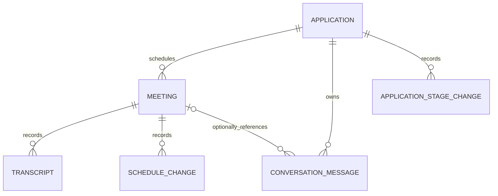

# Meeting and application domain design

Status: proposed backend design, 2026-11-10. No runtime migration or UI changes are part of this document.

The typed records and response shapes are in [meeting-domain-contracts.ts](meeting-domain-contracts.ts).

## Core structure

One job application owns its entire recruiting history. It can have several screening calls, up to six interview rounds, multiple sessions within a round, and one continuous conversation timeline. Offer, Rejected, and Archived are application stages, never meeting kinds.



| Record | Responsibility | Important fields |
| --- | --- | --- |
| Application | Company, role, application stage and stable identity | `id`, `profileId`, `companyName`, `jobTitle`, `stage`, `stageChangedAt`, `sourceRefs` |
| Meeting | A real screening or interview appointment | `id`, `applicationId`, `kind`, `round`, `sequence`, `sessionIndex`, `schedule`, `lifecycle`, `channel`, `topics`, `participants`, joining details |
| ConversationMessage | One message in the application's complete chat/email history | `applicationId`, optional `meetingId`, `sender`, `recipients`, `sentAt`, `bodyText`, optional provider IDs |
| Transcript | The transcript of one particular meeting | `meetingId`, `applicationId`, `rawText`, optional timestamped speaker segments |
| ScheduleChange | An actual reschedule, retaining the old time range | `meetingId`, `previousSchedule`, `nextSchedule`, event time and reason |
| ApplicationStageChange | Movement of the application through its pipeline | `applicationId`, `from`, `to`, `occurredAt` |
| LegacyFragment | Existing information whose identity, timestamp or meeting kind is unknown | Original text/metadata and its source references |

All records have an immutable UUID, revision, creation/update timestamps and a `live` or `mock` partition. A meeting, transcript or message must belong to an application in the same partition. Company name and job title are display fields, not identifiers: applying twice for the same role creates separate application histories.

## Application records versus meetings

`Application.stage` retains the existing values: `applied`, `screen`, `interview`, `offer`, `rejected`, `archived`. `Meeting.kind` permits only `screening` and `interview`. A meeting's kind and round do not change when the application's stage changes.

The board service returns two distinct card types:

| Column | Card type | Source |
| --- | --- | --- |
| Screening | Meeting | Screening appointments for applications currently in screening |
| Interview | Meeting | Interview appointments for applications currently in interview |
| Rejected | Application | One record per rejected application |
| Archived | Application | One record per archived application |
| Offer | Application | One record per application at the offer stage |

An application that reaches Interview keeps its screening calls in its history. An application that reaches an outcome column keeps all its appointments and messages, but that column displays one application record rather than a card for each old round. Outcome cards have no meeting time, phone/video tag, round or join link. Their relevant date is the application's stage-change date, if shown.

Changing an application to Offer does not create an appointment or rewrite an interview into an offer meeting. It also does not silently cancel an existing appointment. Cancellation is an explicit separate command. Existing appointments remain accessible through the application's history.

Applications with no scheduled appointment do not receive invented meetings. They remain available in Applications; scheduling creates an actual Meeting record. A future UI may show a clearly identified application placeholder, but it must use the application card contract.

Dragging an outcome card changes the application stage through `APPLICATION_SET_STAGE`. Moving a meeting must never directly rewrite `Meeting.kind` from one column label to another. Progressing a screening application to Interview updates its stage and can create an interview draft; the screening appointment remains historical data.

## Tags, interview rounds and rescheduling

The tag editor exposes the requested options:

| Display label | Canonical value | Stored source |
| --- | --- | --- |
| Phone | `phone` | `Meeting.channel` |
| Video | `video` | `Meeting.channel` |
| Rescheduled | `rescheduled` | Schedule-change history |
| Panel | `panel` | `Meeting.topics` |
| Marathon | `marathon` | `Meeting.topics` |
| Final | `final` | `Meeting.topics` |
| Technical | `technical` | `Meeting.topics` |
| System Design | `system_design` | `Meeting.topics` |
| Live Coding | `live_coding` | `Meeting.topics` |
| Behavioral | `behavioral` | `Meeting.topics` |
| Cultural | `cultural` | `Meeting.topics` |

Phone and Video are mutually exclusive. Topic tags allow multiple selections without duplicates. Selecting Rescheduled opens the reschedule operation so that the previous and new schedules are recorded. Importing an old `rescheduled: true` creates a legacy reschedule marker with unknown previous time; it does not invent a schedule history.

Interview cards suppress the Video tag even when `channel` is `video`. The stored channel and join URL remain available. A phone interview may show Phone. Screening cards show their actual Phone or Video tag. Outcome records receive no meeting tags.

An upcoming or ongoing scheduled phone meeting requires its own phone number and returns a phone-popup action. A video meeting requires its own validated HTTP(S) join URL and returns an open-link action, including interviews with a hidden Video tag. Past, cancelled and no-show meetings return no joining action; their transcript and conversation capabilities remain available. Drafts may have missing joining details but cannot be published as joinable meetings.

Interview rounds are integers 1–6; screening meetings have `round: null`. Final can occur before round 6. It is a topic, not a forced round number. Panel and Marathon can contain multiple appointments in the same round, identified by distinct meeting IDs and `sessionIndex`; creating another session does not increment the round automatically. Interviewers are a participant list, allowing several interviewers without packing their names into one string.

## Previous meetings and shared chat

Every interview detail response includes a Previous meetings tab capability. It becomes actionable when earlier meeting history exists; a first interview with no preceding meetings has a zero count and an empty-state explanation. Screening details do not have this tab. This resolves “every interview has the option” and “only for progressed meetings” without fabricating previous appointments.

The initial definition of progressed is: the same application has an earlier appointment that has elapsed. For a selected interview `current`, previous-meeting lookup:

1. Uses the same immutable `applicationId` and partition.
2. Excludes `current`, deleted records, drafts and cancelled appointments.
3. Includes both screening calls and earlier interview sessions.
4. Requires `candidate.sequence < current.sequence` and a confirmed end at or before `min(now, current.startsAt)`.
5. Orders results by end time ascending, then sequence, session index and ID.

A past appointment is not automatically declared attended. An elapsed record can still be scheduled/unconfirmed or explicitly marked no-show; its history entry shows that fact. Transcript availability does not establish attendance. Legacy records with an unknown end time appear in a separate “History needing review” result and do not qualify as completed progression until corrected.

The Previous meetings tab can expose sub-tabs such as Screening, Round 1, and Round 2 — Session 1. Selecting a previous appointment loads that appointment's transcript and participants while retaining the current application's context. It does not copy the old meeting into a new record.

Chat history is application-scoped and available from every meeting, regardless of kind, round, or past/future time. It is also available from Offer, Rejected and Archived application records. Opening chat from round 5 shows the same continuous conversation as opening it from round 1, beginning with the first known message. `meetingId` on a message is an optional reference, not the default history filter.

Messages are sorted by `sentAt`, then creation time and ID for deterministic ties. Date separators use the selected display timezone. The rendering contract is:

```text
----- 2026-11-10 -----
Avery Morgan, 2026-11-10 09:10
To: Candidate <candidate@example.test>
Thank you for your time. Your next interview is confirmed.

Candidate, 2026-11-10 09:25
To: Avery Morgan <avery@example.test>
Thank you. I look forward to meeting the team.
```

Each entry preserves sender, all recipients, actual sent time and plain message text. Source message/thread IDs support deduplication; identical text alone is not a safe deduplication key. Missing sender/recipient metadata is shown as unknown rather than inferred from the interviewer. Legacy text without timestamps is retained separately as an undated conversation fragment, not assigned the appointment time or migration time. Once its metadata is corrected it can join the dated timeline with an explicit source link.

Long conversations are paginated oldest first, with a cursor; opening history starts at the first message. Meeting transcripts remain separate records and are never substituted for shared chat.

## Time ranges, timezone and temporal state

New scheduled meetings require both `startsAt` and `endsAt`, stored as UTC instants, with `endsAt > startsAt`. The input timezone is retained for audit. The display timezone comes from Settings → Other, retaining the existing `meeting-timezone:v1` preference. Changing it changes presentation and editor conversion without changing saved instants.

Use `hourCycle: 'h23'`, two-digit hours and minutes. A same-day card shows a date plus `09:30–10:15`, without AM/PM or a timezone on each card. The page header shows the selected timezone. A meeting crossing midnight displays both dates, such as `10 Nov 23:30 – 11 Nov 00:30`. If an interval crosses a daylight-saving offset change, the detail view also identifies the two offsets so repeated local times are unambiguous.

Use the existing timezone conversion helper as the starting point, extending validation to both endpoints. Reject nonexistent local clock times. Preserve the original occurrence of an unchanged ambiguous time; an explicitly edited ambiguous time must be resolved consistently and visibly. Duration is calculated from UTC instants, not subtraction of formatted local clock times.

| Condition | Derived temporal state | Meeting left border |
| --- | --- | --- |
| Cancelled lifecycle | Cancelled | None |
| Incomplete schedule / draft | Unscheduled | None |
| `now < startsAt` | Upcoming | Present |
| `startsAt <= now < endsAt` | Ongoing | Present |
| `endsAt <= now` | Past | None |

Using the end time as the past boundary keeps an ongoing meeting accessible until it finishes. Explicit no-shows have no joining action and are included in past history once their slot has elapsed. A future slot cannot be marked completed/no-show without correcting its time or recording an explicit override reason.

Interview color derives from round 1–6, light to dark. Upcoming/ongoing rounds 4–6 use a light left-border color for contrast. All past interview rounds have no left border, including rounds 4–6. This rule replaces the current exception that retains borders on every interview. CSS color and border width are derived presentation values, not stored attributes. Outcome-card styling is independent of meeting timing.

## Initial scroll position and board ordering

Screening and Interview each receive `initialFocusMeetingId` from the service. Selection occurs after search/date filters and application-stage filtering. For each column:

```text
ongoing = eligible ongoing appointments, ordered by endsAt then startsAt
upcoming = eligible future appointments, ordered by startsAt then endsAt
past = eligible elapsed appointments, ordered by endsAt descending
focus = first(ongoing) ?? first(upcoming) ?? first(past) ?? null
```

“Most upcoming” means the nearest upcoming appointment, not the furthest future date. “Most previous” means the most recently ended appointment. Cancelled meetings, drafts, incomplete schedules and no-shows are not initial focus targets. Displayable history remains available even when it is not a focus target.

The meeting list itself is chronological, with stable ID tie-breakers. Return a page around the focus ID so a long history does not prevent loading the desired appointment. Once cards are rendered, the client aligns that card with the top of its column's scroll area. When necessary, use temporary bottom scroll padding so the newest past card can reach the top even if it is the last item.

Do this once on initial load, including a reload, for each meeting column. Do not reset the user's scroll on clock ticks, metadata saves or storage-change notifications. An explicit filter change may request a new focus result. Outcome columns use application-stage timestamps and do not use meeting auto-scroll.

## Storage, identity and service boundary

This repository has a Chrome extension service worker, shared legacy application storage, and the extension-owned IndexedDB wrapper in `extension/studio/storage.js`. The first implementation should use those facilities rather than requiring a new hosted server.

Proposed record keys in private IndexedDB are `application:<id>`, `meeting:<id>`, `conversation-message:<id>`, `transcript:<id>`, `schedule-change:<id>`, `application-stage-change:<id>`, and `legacy-fragment:<id>`. Persist small application-to-meeting/message indexes transactionally. Large transcript/message bodies are loaded only when their tabs open; they are not included in board responses. Mock records use the same contracts but a separate partition and are excluded from real application statistics and sync.

The service worker owns writes. Mutations carry `mutationId` and expected revisions, and validate both entity identity and partition. Related changes, revisions, indexes and the idempotency receipt commit in one IndexedDB transaction. Retrying the same mutation returns the original result; reusing its ID with different data is rejected. Conflicts return current revisions without discarding the user's form text.

The existing storage wrapper supports atomic multi-key writes but separate `get()` and `set()` calls are not atomic compare-and-update. Add a repository transaction primitive to check revisions and write related keys in the same read/write transaction. A per-worker promise queue is useful but is not a substitute for transaction checks or restart-safe receipts.

Stable application identity is a prerequisite. The current web adapter can derive IDs from mutable job/date/profile fields, while the dock has a separate alias scheme. Introduce one canonical UUID registry shared by the dock and web providers. Store remote IDs as source references. Legacy rows without a stable ID require a persisted tracker ID that every application edit/import/sync path preserves. Do not match applications solely by company and title.

`chrome.storage.local.appliedList` and IndexedDB cannot be committed in a single transaction. Updates to the legacy compatibility view therefore use a durable outbox/journal: commit canonical data and the pending bridge update, write the compatibility view, then mark it delivered. Replay pending entries after a service-worker restart. Stop direct page writes as each provider is moved behind this service, otherwise concurrent edits can bypass identity/revision checks.

Use the existing versioned runtime envelope. Authorize trusted extension pages and resolve the active profile/account context in the worker. The caller must not be able to substitute another record's application ID to read its transcript. A future inline-dock integration must use its existing document grant and explicit operation allowlist. Publish invalidation IDs/revisions instead of conversation bodies.

| Operation | Request | Result / effect |
| --- | --- | --- |
| `MEETINGS_BOARD_GET` | Filters, partition, column cursors | Typed meeting/application cards, focus IDs, current time and timezone |
| `MEETING_GET` | Meeting ID | Appointment details, tab capabilities and previous-meeting count |
| `MEETING_CREATE` | Application ID, appointment fields, expected application revision | New immutable meeting ID and assigned sequence |
| `MEETING_UPDATE` | Meeting ID, field changes, expected revision | Validated metadata; schedule changes go through reschedule |
| `MEETING_RESCHEDULE` | Meeting ID, new start/end, timezone, expected revision | Same meeting ID plus a schedule-history entry |
| `MEETING_SET_LIFECYCLE` | Meeting ID, desired lifecycle, expected revision | Explicit completion/cancellation/no-show without changing application stage |
| `MEETING_PREVIOUS_GET` | Current interview ID, cursor | Earlier eligible appointments from that application only |
| `MEETING_TRANSCRIPT_GET` / `MEETING_TRANSCRIPT_SAVE` | Meeting ID; text/segments and expected revision for save | Meeting-specific transcript |
| `APPLICATION_CONVERSATION_GET` | Application ID, oldest-first cursor | Full shared history, date groups and undated legacy fragments |
| `APPLICATION_MESSAGE_SAVE` | Application ID, optional meeting ID, message metadata | Validated/deduplicated message; no external message is sent |
| `APPLICATION_SET_STAGE` | Application ID, stage, expected revision | One application-stage change; preserves all history |

Error codes distinguish `CONFLICT`, `NOT_FOUND`, `INVALID_TIME_RANGE`, `INVALID_ROUND`, `INVALID_TAG`, `INVALID_APPLICATION_LINK`, and `MIGRATION_REVIEW_REQUIRED`. Every asynchronous request settles with a success or error response, preserving the earlier fixes for hanging message channels.

## Migration of the current data

Current inputs are `appliedList`, `meeting-mock-cards:v1`, `meeting-mock-cards:version`, `meeting-details:v1`, and `meeting-timezone:v1`. Existing mock rows embed a single meeting and free-text chat; real meeting details are attached to IDs from the application adapter. Both need reconciliation before enabling the new UI.

1. Save a versioned backup and a migration manifest. Do not overwrite the existing stores in place.
2. Build the canonical application registry and alias map. Ambiguous or orphaned legacy references remain preserved for review; they must not silently attach to a different application.
3. For the known mock dataset, explicitly map the six Orbit rounds to one mock application and the six Cedar rounds to another. Use their known fixture IDs, not fuzzy company-name matching. Preserve edited text and deletion state.
4. Convert the 22 screening/interview sample cards into 22 Meeting records. Convert the other 8 sample cards into application outcome records, not appointments. This yields 20 mock applications and 22 meetings for the unmodified current dataset, while preserving 30 board cards.
5. Give known mock appointments explicit sample end times. Real records missing an end time retain `needs_review`; never pretend that a guessed 30/60-minute duration was imported fact.
6. Preserve transcripts on their meeting. Move parseable messages into the application's conversation without copying them onto every round. Preserve current undated chat strings as legacy fragments. For a fresh mock seed, generate properly timestamped sample messages with sender and recipient metadata.
7. The old outcome sample rows contain generated phone/video/transcript fields. Retain their raw payload in the migration backup/legacy metadata instead of generating fictitious historical meetings. Real outcome records with unclassified appointment metadata likewise require an explicit meeting kind before promotion into meeting history.
8. Store reschedule markers, timezone preference, source mappings, migration status and all record counts. Re-running migration must not duplicate entities or restore deleted samples.
9. Switch reads to the new service only after migration validation. Complete any pending legacy-view bridge writes through the journal. Keep the backup and reviewable unresolved items until the migration is accepted.

Changing an application's title/date or assigning a remote sync ID must preserve its canonical ID and its meeting/message associations. Archived or rejected applications retain their histories. Purging an application requires an explicit operation that handles linked records together; normal stage changes do not delete anything.

## Implementation order and acceptance checks

Implement stable application identity, transactional repositories and migration first; then meeting/history/conversation service commands; then board projections and UI integration. The current compiled web adapter should become a compatibility layer rather than the owner of meeting business rules.

Before UI integration, verify:

- Outcome stages cannot create Meeting records or leak meeting-only fields into their card responses.
- Renaming a role, rescheduling a meeting, syncing a remote ID, and restarting the worker preserve application links and create no duplicate history.
- Previous-meeting queries never cross applications; an interview with only a previous screening call has valid history, and a first interview without history returns an empty result.
- Chat from any round returns the same oldest-first application timeline, including messages before the first meeting and after an offer. Missing metadata remains explicitly unknown.
- The exact tag set is enforced; interview Video tags are hidden without removing the join link; round 7 is rejected; several sessions can share one round.
- Time ranges validate both endpoints, support overnight intervals and daylight-saving transitions, and render with 24-hour time in the saved timezone.
- Past interview borders are absent at every round; future/ongoing rounds 4–6 use a light border.
- Initial focus chooses ongoing, then nearest upcoming, then most recent past; it respects filters and pagination and does not reset manual scrolling on background updates.
- Migration is repeatable, preserves user edits/deletions and real application totals, and never fabricates timestamps or message participants.

The only behavioral interpretations introduced here are that ongoing meetings keep their border until their end time, and that Previous meetings is present on every interview but has content only after earlier meetings have elapsed. Both are explicit service rules, so the UI can implement them consistently.
